Opinionated experimental research lab for Pi and DeepSeek Harness.  
Long horizon. Structured, creative, grounded discovery.  

### Give it something difficult

| Mission | Example Challenge |
|---|---|
| **RED** | Hunt another critical vulnerability in php-src. |
| **BLUE** | Patch downstream exposure and vulnerabilities. |
| **MATH** | Improve upon the Navier–Stokes OpenAI solution. |
| **SIGNALS** | Discover and track news before its breaks. |

### Install

```sh
pi install git:github.com/kodareef5/persistent-eclipse
```

```sh
dsh plugin --profile web add github:kodareef5/persistent-eclipse
```

### Source map

```text
src/missions/ ──┐
src/skills/  ───┼─ build.py → cordis.patch.yml
src/research.md ┘                  │
                              Pi or DSH
```

Persistent Eclipse intentionally runs without its own sandbox.  
Use a dedicated, isolated environment.  
Monitor execution and resources. 

[Build details](src/README.md) · [Remote operation](REMOTE-OPERATOR-COMMS.md)
